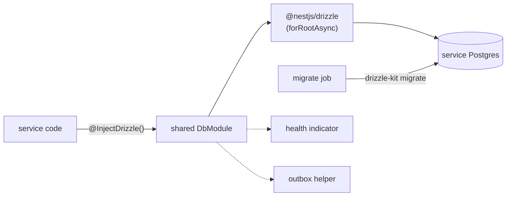

# ADR-0005: ORM

> **Decision:** **Drizzle ORM** (v1, pinned) on **node-postgres**, through `@nestjs/drizzle`, for **every** stateful service.
> **Why:** reviewable SQL migrations and compile-time types that come straight from the schema, at low cost per service.

## Context

[ADR-0001](0001-service-granularity.md) splits the server into ~12–15 services, written in NestJS / TypeScript ([ADR-0002](0002-backend-framework.md)). [ADR-0004](0004-persistence.md) gives each stateful service **its own PostgreSQL database and role**, all on one instance for the MVP. Cross-service consistency uses events and the **outbox pattern**. We need to decide **how services talk to their database**: schema definition, queries, transactions and migrations.

- Schemas are **small** (a few tables per service) and never joined across services.
- Every stateful service writes a business row **and** an outbox row in one transaction. A relay polls the outbox with `FOR UPDATE SKIP LOCKED`.
- The `workflow` service stores workflow graphs as typed **JSONB**.
- Migrations must run on **Kubernetes** (several replicas, rolling updates) and with **Docker Compose** from a fresh clone.
- Nest provides first-party integrations for four ORMs: **TypeORM, Drizzle, Mongoose, Sequelize**. We compare these.

## Decision drivers

1. **Migration reliability** (primary): generated, reviewable, reproducible migrations that run safely as a release step on K8s and Compose.
2. **End-to-end type safety**: query results are typed from the schema, so schema drift breaks the build rather than production.
3. **Light per-service footprint**: startup time and memory are multiplied by ~15 pods (an ADR-0001 cost).

## Options compared

|                            | TypeORM      | **Drizzle**    | Sequelize    | Mongoose       |
| :------------------------- | :----------- | :------------- | :----------- | :------------- |
| Nest package               | `@nestjs/typeorm` | `@nestjs/drizzle` | `@nestjs/sequelize` | `@nestjs/mongoose` |
| Works with Postgres        | 🟢 Yes       | 🟢 **Yes**     | 🟢 Yes       | 🔴 No (MongoDB) |
| 1. Migration reliability   | 🟡 Diff-generated, often noisy | 🟢 **Diff-generated readable SQL** | 🔴 Hand-written | —              |
| 2. Type safety             | 🟡 Hand-declared entities, loose QueryBuilder | 🟢 **Inferred from schema, incl. partial selects** | 🔴 Bolted-on types | —              |
| 3. Footprint               | 🔴 Heavy (`reflect-metadata`, large tree) | 🟢 **Thin runtime** | 🟡 Medium    | —              |
| Postgres features (JSONB, `SKIP LOCKED`) | 🟡 Via QueryBuilder | 🟢 **First-class** | 🟡 Clunky    | —              |
| Maturity                   | 🟢 Most used in Nest, large bug backlog | 🟡 **Young, v1 in RC** | 🟡 Stagnant (v7 in alpha for years) | —              |

- **Mongoose**: MongoDB only. Ruled out by the PostgreSQL choice in ADR-0004.
- **Sequelize**: worst score on both top drivers (hand-written migrations, weak TypeScript).
- **TypeORM**: mature, and its entities/repositories feel familiar in Nest. Its strengths (relation graphs, cascades, change tracking) matter little with small schemas per service, and loosely typed queries go against driver 2. This is the **fallback**.
- **Drizzle**: best on all three drivers. The cost is maturity, which we contain by pinning (see Rules).

Not compared: Prisma (no Nest package, generated client adds a codegen step, raw SQL needed for `SKIP LOCKED`) and MikroORM (package maintained outside the Nest team). Both are reasonable. We limited the comparison to the Nest-maintained integrations.

## Decision

### How a service uses it



```ts
await this.db.transaction(async (tx) => {
  await this.workflows.insert(tx, wf);
  await this.outbox.add(tx, 'workflow.created', wf);
});

const batch = await this.db.select().from(outbox)
  .where(isNull(outbox.sentAt)).limit(100)
  .for('update', { skipLocked: true });
```

### Rules

| Topic          | Rule                                                                                                                                                                       |
| -------------- | -------------------------------------------------------------------------------------------------------------------------------------------------------------------------- |
| Uniformity     | **One ORM everywhere.** Every stateful service uses Drizzle through the shared `DbModule`.                                                                                  |
| Integration    | The shared `DbModule` wraps `DrizzleModule.forRootAsync` (official `@nestjs/drizzle`) and adds: env config convention (the service's own `DATABASE_URL`, pool size per replica as required by ADR-0004), outbox helper, `migrate` entrypoint, SYS-HEALTH indicator. |
| Driver         | `node-postgres` (`pg`), as in the Nest documentation.                                                                                                                      |
| Version        | Drizzle **v1 RC**, `drizzle-orm` and `drizzle-kit` pinned to an **exact** version at the monorepo root. All services are upgraded together in one PR.                      |
| Transactions   | `tx` is **passed explicitly** to methods that must join a transaction. No implicit context (`nestjs-cls`).                                                                  |
| Schema privacy | A Drizzle schema is **private to its service**. Message contracts and API DTOs are separate types in the shared contracts package, never derived from row types.           |
| Authoring      | `drizzle-kit generate` produces SQL that is committed and reviewed in the PR. Custom SQL may be added. `drizzle-kit push` is only allowed on a developer's local database. |
| Drift check    | **CI fails** if the schema has changed without a matching migration (`generate` produces a diff).                                                                           |
| Execution      | Migrations run as a **one-shot job** per service: a K8s Job / Helm pre-upgrade hook, and a Compose one-shot service that apps wait on with `service_completed_successfully`. Never on app startup. |
| Compatibility  | **Forward-only**, no down migrations. Breaking changes follow **expand/contract** across releases, so the previous image always works against the new schema.              |
| Tests          | Persistence tests run against a real Postgres (**Testcontainers**) with the committed migrations applied. Business-logic unit tests may mock `getDrizzleToken()`.          |

## Consequences

**Good**

- Migrations are plain SQL files, readable in review, and the same files run in CI, Compose and K8s.
- Schema drift is caught at compile time (types) and in CI (drift check), not at deploy time.
- Postgres features the architecture relies on (`SKIP LOCKED` for the outbox relay, typed JSONB for workflow graphs) are first-class.
- A thin runtime per pod helps size the demo cluster.
- Rolling updates and image rollback are safe thanks to forward-only expand/contract.

**Bad**

- Drizzle v1 is still a release candidate: there may be bugs and API changes before stable. Each upgrade must be deliberate.
- There is no repository layer or change tracking. Developers must be comfortable with SQL.
- Passing `tx` explicitly makes signatures noisier.
- Expand/contract turns some schema changes into two or three releases.
- Testcontainers needs Docker in CI and makes the test suite slower.

## Confirmation

The decision holds only if all of these pass. Otherwise, fall back to TypeORM (or to Drizzle 0.x stable if the issue is specific to the RC).

- [ ] **Fresh clone**: `docker compose up` runs every migrate job, then starts the services against migrated databases.
- [ ] **Drift check**: a PR that changes a schema without a migration fails CI.
- [ ] **Rolling deploy**: an expand migration is applied while old and new pods run side by side. Rolling back the image works with no schema change.
- [ ] **Outbox**: two relay instances using `SKIP LOCKED` never publish the same outbox row twice (Testcontainers test).
- [ ] **Typed JSONB**: a workflow graph round-trips through `jsonb().$type<WorkflowGraph>()` with compile-time types.
- [ ] **Footprint**: startup time and memory of one service are measured and fit the demo cluster budget.

## Revisit when

- Drizzle v1 goes stable (unpin from the RC), or an RC upgrade breaks generated migrations.
- A service needs complex relation graphs or change tracking that SQL-style code handles badly.

## Related

- [ADR-0001: Service granularity](0001-service-granularity.md) (one database per service, outbox pattern).
- [ADR-0002: Back-end framework](0002-backend-framework.md) (NestJS).
- [ADR-0004: Persistence engine and topology](0004-persistence.md) (PostgreSQL, database and role per service, migrations before start, connection budget).
- Nest documentation: [Data › Drizzle](https://docs.nestjs.com/data/drizzle).
- Requirements: [CLAUDE.md](https://github.com/Matt4401/area/blob/main/CLAUDE.md).
