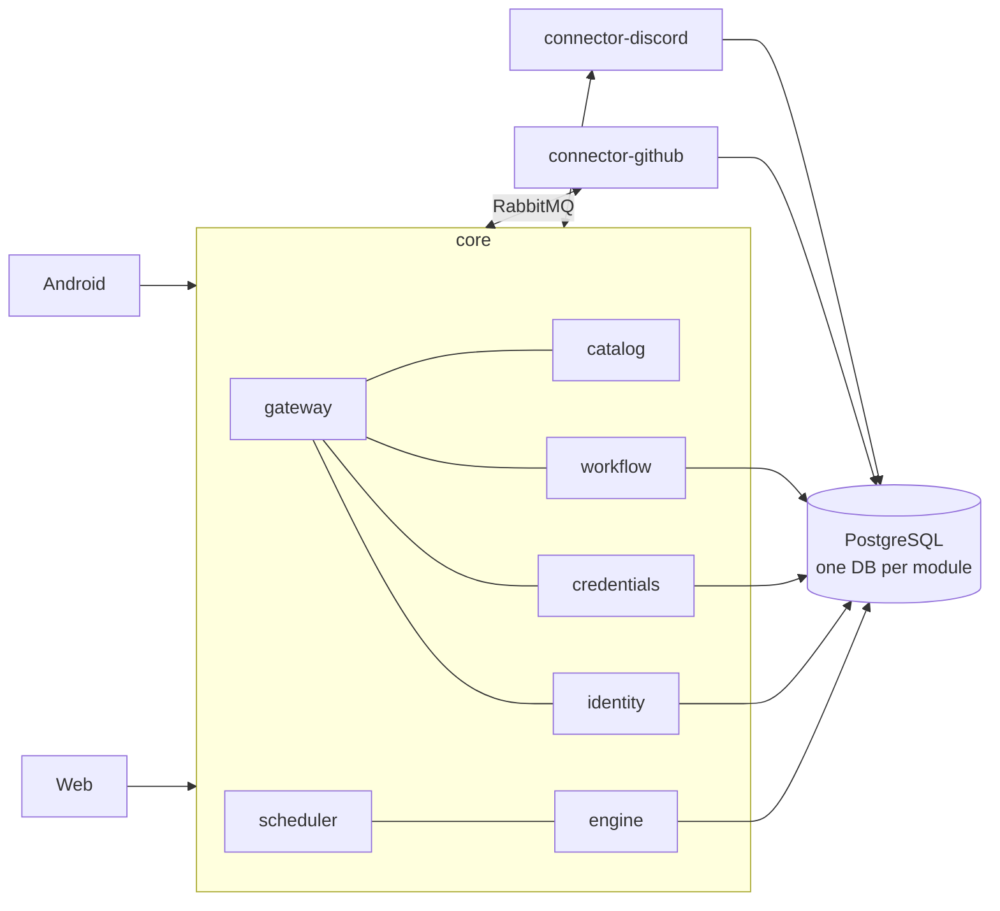

# MVP scope

What the AREA MVP (week 4) delivers, how it is built, and how each claim can be checked. Decisions are recorded in [ADRs](adr/); this page links to them instead of repeating them.

## At a glance

| Area            | MVP                                                                                     |
| --------------- | --------------------------------------------------------------------------------------- |
| Services        | `core` + one microservice per connector ([ADR-0006](adr/0006-mvp-service-split.md))    |
| Connectors      | **GitHub** (OAuth2) and **Discord**                                                     |
| Messaging       | **RabbitMQ** between `core` and connectors                                              |
| Data            | **PostgreSQL**, one database and role per module and per connector, one instance ([ADR-0004](adr/0004-persistence.md)) |
| ORM             | **Drizzle** (v1 RC, pinned) on `node-postgres`, via a shared `DbModule` ([ADR-0005](adr/0005-orm.md)) |
| Back end        | NestJS / TypeScript ([ADR-0002](adr/0002-backend-framework.md))                         |
| Web             | Vue 3, full flow including the Builder ([ADR-0003](adr/0003-frontend-framework.md))     |
| Mobile          | Android (Jetpack Compose), minimal                                                      |
| Languages       | French and English, web and mobile                                                      |
| Run             | **Docker Compose** only. Kubernetes comes after the MVP.                                |
| Features shown  | ENG-EXT, ENG-ASYNC, ENG-RETRY, SYS-HEALTH                                               |

## Architecture



`core` is one NestJS app made of modules that never share a database. Connectors are separate NestJS apps. **Every exchange between `core` and a connector goes through RabbitMQ.** This is what lets `core` be split later without touching connectors (see [ADR-0006](adr/0006-mvp-service-split.md)).

### Message flows

| Flow           | From → to                   | Pattern                | Content                                     |
| -------------- | --------------------------- | ---------------------- | ------------------------------------------- |
| Manifest       | connector → `catalog`       | Event, at startup      | Versioned list of Actions and REActions     |
| Poll tick      | `scheduler` → connector     | Command                | Trigger id, user id, cursor                 |
| Event detected | connector → `engine`        | Event                  | Trigger id, event key, published keys       |
| Reaction job   | `engine` → connector        | Command, acked         | Run id, node id, resolved parameters        |
| Job result     | connector → `engine`        | Event                  | Run id, node id, status, published keys     |
| Token request  | connector → `credentials`   | RPC (request / reply)  | User id, service → short-lived access token |

Access tokens are **never** put in a persisted message or a dead-letter queue. Connectors ask for them at the moment they act.

Events that follow a database change (event detected, job result) are written to an **outbox table in the same transaction** as the change, then published by a relay that reads the outbox with `FOR UPDATE SKIP LOCKED` ([ADR-0005](adr/0005-orm.md)). A crash between the commit and the publish loses nothing.

## Data and migrations

| Owner               | Databases                                         |
| ------------------- | ------------------------------------------------- |
| `core`              | `identity`, `credentials`, `workflow`, `engine`   |
| `connector-github`  | `connector_github` (dedup keys, cursors, outbox)  |
| `connector-discord` | `connector_discord` (completed jobs, outbox)      |

- Each module's Drizzle schema is **private** to it. Message contracts and API DTOs live in the shared `contracts` package, never derived from row types.
- `drizzle-kit generate` produces SQL migrations that are **committed and reviewed**. `push` is only for a developer's local database.
- Migrations run in a **one-shot Compose service per owner** (`core-migrate`, `connector-github-migrate`, `connector-discord-migrate`) before the app starts. Apps wait with `depends_on: condition: service_completed_successfully`. Never on app startup.
- Migrations are **forward-only**.
- Workflow graphs are stored as typed JSONB (`jsonb().$type<WorkflowGraph>()`).

## Users and authentication

| Capability                 | Web | Mobile | Notes                                                            |
| -------------------------- | :-: | :----: | ---------------------------------------------------------------- |
| Register (local)           | ✅  | —      | Username, email, password (hashed)                               |
| Confirm account by email   | ✅  | —      | Real SMTP provider; credentials only from environment variables |
| Log in (local)             | ✅  | ✅     |                                                                  |
| Log in with Google (OIDC)  | ✅  | ✅     | Mobile uses AppAuth with PKCE and a custom redirect scheme      |
| Connect GitHub (OAuth2)    | ✅  | —      | Tokens stored encrypted by `credentials`, refreshed when needed |

OIDC answers *who the user is*. OAuth2 answers *what AREA may do on GitHub for them*. They are stored separately (`identity` vs `credentials`).

## Hooks

- `scheduler` publishes a **poll tick** for every enabled trigger at its interval.
- The GitHub connector calls the GitHub API from the trigger's last cursor (conditional requests with ETag where available).
- Each event is inserted with a unique `(trigger_id, event_key)`. An existing key is ignored, so the **same event never starts two runs**, even after a restart.
- No client needs to be open.

Webhooks are out of scope for the MVP: the product runs locally under Compose without a public URL.

## Workflows

### Structure (checked when saving)

- A trigger, then a linear chain of reactions.
- At most one condition, never nested, with exactly two branches.
- Branches end the workflow and never merge.
- **An empty branch is valid** and ends the run successfully.
- No limit on the number of reactions.
- Every `{{ node.key }}` must reference a key **declared** by an earlier node. Otherwise saving is refused.

### Conditions

A condition is one or more rules combined with a single `AND` or `OR`. A rule is `key` + operator + value.

| Operators                                                          |
| ------------------------------------------------------------------ |
| `equals`, `not_equals`, `contains`, `not_contains`, `exists`, `greater_than`, `less_than` |

There is no expression language. **User input is never evaluated as code.** `{{ }}` substitution only replaces data.

### Runtime semantics

| Situation                                          | Behaviour                                                                                         |
| -------------------------------------------------- | ------------------------------------------------------------------------------------------------- |
| Reaction fails with a transient error (5xx, timeout, rate limit) | Retried up to **3 times** with exponential backoff                                |
| Still failing after the last retry                 | Run ends as **`failed`**. Following nodes do not run. The job goes to the **dead-letter queue**.  |
| Declared key missing at runtime                    | Node fails immediately with a `missing_key` error, **no retry** (the result would be the same)    |
| Connector restarts during a job                    | Job is redelivered: messages are acknowledged only after processing                               |
| Branch is empty                                    | Run ends as **`succeeded`**                                                                       |

Reactions must be idempotent on redelivery: each job carries `run_id + node_id`, and connectors ignore a job they have already completed.

## Clients

### Web (full flow)

Register → confirm email → log in → connect GitHub → open the Builder → create a workflow with a trigger, ≥ 2 reactions and a condition → map data with `{{ }}` → save → enable → see run history.

- The Builder is a canvas on `@xyflow/vue`. It refuses invalid shapes as you edit; the server validates again at save.
- Action and REAction forms are generated from `about.json`. Nothing is hard-coded.

### Android (minimal)

- Configure the server address.
- Log in (local or Google).
- List workflows, enable or disable them.
- See recent runs and their status.

No building on mobile.

### Languages

French and English on the whole flow, on both clients. Every visible string goes through the i18n layer.

## API contract

- `core` serves the **OpenAPI** description and a browsable UI, generated from the code.
- It covers every MVP endpoint, error responses included.
- **CI regenerates the description and fails on any difference**, starting at the MVP.
- `about.json` exposes Services, Actions and REActions with identifiers, descriptions and parameters, built from connector manifests.

## Additional features shown at the MVP

| Feature    | Where it is observable at the MVP                                                                 | Left for the Final                      |
| ---------- | ------------------------------------------------------------------------------------------------- | --------------------------------------- |
| ENG-EXT    | Connectors register at startup; adding one appears in `about.json` without touching `core`       | Live run of `HOWTOCONTRIBUTE.md`        |
| ENG-ASYNC  | Runs execute in connector workers via RabbitMQ; stopping a connector loses no job                 | Timeouts and capacity set by config     |
| ENG-RETRY  | Bounded retries with backoff, dead-letter queue                                                   | DLQ inspection and replay, policy in config |
| SYS-HEALTH | Health endpoint per dependency: PostgreSQL, RabbitMQ, Google OIDC, scheduler                      | Response time and no-secret checks      |

## Build and run

```bash
cp .env.example .env   # fill in OAuth, OIDC and SMTP values
docker compose up --build
```

| Container           | Purpose                                         |
| ------------------- | ----------------------------------------------- |
| `core`              | API, OpenAPI UI, `about.json`                   |
| `connector-github`  | GitHub Actions and REActions                    |
| `connector-discord` | Discord REActions                               |
| `web`               | Vue 3 static build                              |
| `postgres`          | One database and role per module and connector  |
| `*-migrate`         | One-shot: applies Drizzle migrations, then exits |
| `rabbitmq`          | Broker and management UI                        |
| `apk-builder`       | Builds the installable Android APK              |

**No Kubernetes at the MVP.** The K8s parts of the ADRs (migrate Jobs, Helm hooks, rolling deploys, replica scaling) apply from the Final, with SYS-K8S. At the MVP, each service runs as a single Compose container.

Exact ports and URLs are listed in the README once the stack exists. Secrets come only from the environment; `.env.example` lists every variable with no real value.

## CI

Every contribution runs, with failures visible on the pull request:

- **lint, tests and build** for `core`, connectors, web and Android;
- the **OpenAPI drift check**: the description regenerated from the code must match the committed one;
- the **migration drift check**: a schema change without a generated migration fails;
- **persistence tests** against a real PostgreSQL (Testcontainers) with the committed migrations applied.

## Acceptance checklist

- [ ] `docker compose up` on a fresh clone runs every migrate service, then starts the whole stack and builds the APK.
- [ ] Killing a connector between a database commit and the publish still delivers the event exactly once (outbox).
- [ ] CI fails on a schema change without a migration.
- [ ] A new user registers, receives the confirmation email, confirms, and logs in. The same works with Google, on web and mobile.
- [ ] The user connects GitHub; no token appears in logs, messages or the dead-letter queue.
- [ ] The team's demo workflow (GitHub trigger, ≥ 2 reactions, one condition) is built in the Builder and saved.
- [ ] Saving a workflow that references an undeclared key, merges branches or nests a condition is refused.
- [ ] The workflow fires with every client closed, and a given GitHub event triggers exactly one run.
- [ ] Making Discord fail produces 3 retries, a `failed` run and a dead-letter entry.
- [ ] Restarting a connector during a run loses no job and duplicates no side effect.
- [ ] Mobile lists the workflow, disables it (it stops firing), and shows its runs.
- [ ] The whole flow works in French and in English.
- [ ] CI fails when the OpenAPI description and the code disagree.
- [ ] The health endpoint reports each dependency and fails when PostgreSQL or RabbitMQ is stopped.

## Out of scope for the MVP

- Kubernetes: manifests, Helm, migrate Jobs, rolling deploys, multiple replicas (SYS-K8S).
- Splitting `core` into separate services.
- PgBouncer: one container per service stays well under `max_connections`.
- GitHub webhooks.
- More than two connectors.
- Observability dashboards (SYS-OBS).

## Still open

| Topic            | Owner / next step |
| ---------------- | ----------------- |
| Demo workflow    | Team choice       |
