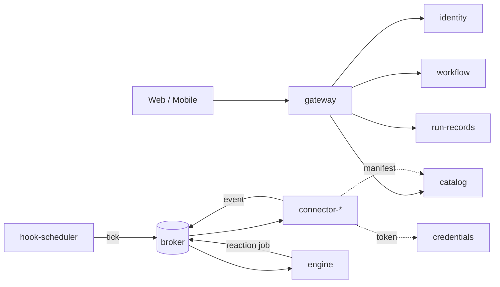

# ADR-0001: Service granularity

> **Decision:** microservices, with **one service per connector** and **one database per service**.
> **Why:** each part scales on its own, and a failure (third-party API or database) stays contained.

## Context

The AREA server detects events in third-party services (hooks), runs workflows, and calls third-party APIs that are often slow or down. We need to decide **how to split the server into deployable units**.

- Team: 4 members, experienced with Kubernetes and distributed systems.
- Targeted features: SYS-K8S, ENG-ASYNC, SYS-OBS, SYS-HEALTH, ENG-EXT, ENG-RETRY.
- The product must also run with **Docker Compose**, not only Kubernetes.

## Decision drivers

1. **Independent scalability** (primary): hooks, engine and each connector scale separately.
2. **Fault isolation**: one failing API or database must not take the product down.
3. **Extensibility**: adding a connector touches only that connector (ENG-EXT).
4. **Async and retryable execution**: a worker restart loses no work (ENG-ASYNC, ENG-RETRY).

## Options compared

|                            | Monolith   | Macroservices | Miniservices | **Microservices** |
| :------------------------- | :--------- | :------------ | :----------- | :---------------- |
| Deployable units           | 1          | 2             | ~5           | **~12–15**        |
| 1. Independent scalability | 🔴 No      | 🟡 Partial    | 🟡 Partial   | 🟢 **Yes**        |
| 2. Fault isolation         | 🔴 No      | 🔴 No         | 🟡 Partial   | 🟢 **Yes**        |
| 3. Extensibility           | 🟡 Partial | 🟡 Partial    | 🟢 Yes       | 🟢 **Yes**        |
| 4. Async and retries       | 🟡 Partial | 🟢 Yes        | 🟢 Yes       | 🟢 **Yes**        |
| Operating cost             | 🟢 Low     | 🟢 Low        | 🟡 Medium    | 🔴 **High**       |

- **Monolith**: everything scales and fails together.
- **Macroservices** (`api` + `runtime`): all connectors share one process, so a slow API slows everything.
- **Miniservices**: clean boundaries, but connectors still share one worker. This is the **fallback** if microservices cost too much.
- **Microservices**: the only option that meets all four drivers. The cost is accepted given the team's experience.

## Decision

### Architecture

Solid arrows: HTTP or broker messages. Dotted arrows: synchronous internal calls.

### Services

| Service            | Role                                                                 |
| ------------------ | -------------------------------------------------------------------- |
| `gateway`          | Public HTTP API, OpenAPI, auth checks (stateless)                    |
| `identity`         | Local accounts and OIDC login (_who the user is_)                    |
| `credentials`      | Encrypted OAuth2 tokens and refresh (_what the app may do_)          |
| `workflow`         | Workflow CRUD and validation at save                                 |
| `catalog`          | Collects connector manifests, serves `about.json`                    |
| `hook-scheduler`   | Decides _when_ to poll each trigger                                  |
| `engine`           | Walks workflows, substitutes `{{ }}`, dispatches reactions           |
| `run-records`      | Single store of execution records (SYS-OBS)                          |
| `connector-<name>` | One per third-party service: polls, deduplicates, executes reactions |

### Rules

| Topic         | Rule                                                                                                                                         |
| ------------- | -------------------------------------------------------------------------------------------------------------------------------------------- |
| Communication | Execution path goes through a **broker** (durable, retries, dead-letter queue). Synchronous calls only for lookups (e.g. fetching a token).  |
| Data          | **One database per stateful service.** No service reads another's database. Consistency between services uses events and the outbox pattern. |
| Tokens        | Only `credentials` stores OAuth2 tokens. Connectors fetch short-lived access tokens.                                                         |
| Catalogue     | Each connector **registers its manifest at startup**. Nothing is hard-coded.                                                                 |
| Messages      | Every message has a `schemaVersion`. Changes are additive only. Consumers are covered by contract tests.                                     |
| Code          | **Monorepo** with a shared connector SDK and shared message contracts.                                                                       |

### Why one database per service

A database is one of the components most likely to fail (full disk, crash, failed migration). With a shared database, its failure stops **everything**. With one per service, it stops **one service**.

Rejected alternative: one shared instance with a schema per service. It is cheaper to run, but it is a single point of failure.

## Consequences

**Good**

- Each connector, the engine and the scheduler scale on their own queue length.
- A failing API or database only affects its own service.
- A new connector is a new service and appears in `about.json` automatically.
- A worker restart loses no work (messages are acknowledged after processing).

**Bad**

- ~12–15 services plus their databases to deploy, monitor and back up. This must be templated (Helm chart, Compose anchors).
- One run crosses 4+ services, so correlation IDs and tracing are mandatory.
- No joins or transactions between services. Data is eventually consistent.
- Higher resource usage, so the demo cluster must be sized early.

## Confirmation

The decision holds only if all of these pass. Otherwise, fall back to miniservices.

- [ ] **Load test**: a burst on one connector scales **only** that connector. API latency stays flat.
- [ ] **API failure**: a third-party API returns 503. Other workflows keep running, and failed jobs land in the dead-letter queue and can be replayed.
- [ ] **Database failure**: stop one service's database. Only that service is unhealthy, and it recovers without losing messages.
- [ ] **Pod deletion**: delete pods during a run. No run is lost or duplicated.
- [ ] **Extensibility**: add a connector via `HOWTOCONTRIBUTE.md` without touching other services.
- [ ] **Footprint**: the full stack runs on the demo cluster and with Docker Compose.

## Related

- Next ADRs: broker, database engine, back-end framework, workflow engine.
- Requirements: [CLAUDE.md](../../CLAUDE.md).
